<p align="center">
  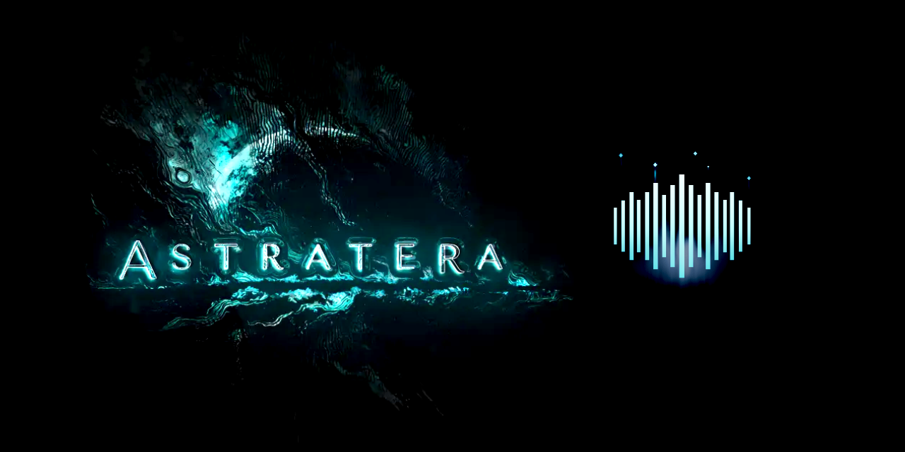
</p>

<h1 align="center">Astratera Chronist</h1>

<p align="center">
  Look back on a recorded D&amp;D session: waveform, chapters, music and transcript on <b>one timeline</b>.<br>
  Click anywhere and play from there. Local, offline, read-only.
</p>

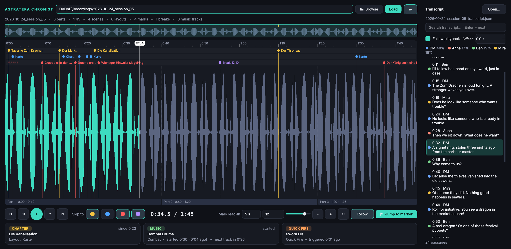

Chronist opens a session folder written by the Weltentor recorder and shows everything that happened on one timeline:
the audio of all parts as a single waveform, the scenes, layouts, manual marks and breaks, the music and sound effects
that were running, and the transcript with speaker labels. It only **reads** your files, never changes the recording,
and nothing leaves your computer.

## Contents

- [Quick start](#quick-start)
- [What it does](#what-it-does)
- [Tour of the window](#tour-of-the-window)
- [Keyboard shortcuts](#keyboard-shortcuts)
- [How the session folder is read](#how-the-session-folder-is-read)
- [Build the exe](#build-the-exe)
- [Troubleshooting](#troubleshooting)
- [Project files](#project-files)
- [License](#license)

## Quick start

1. Start `AstrateraChronist.exe` (or run it from source, see below).
2. Paste the path of a session folder, e.g. `D:\DnD\Recordings\2026-10-24_session_05`, or press **Browse**. Dropping the folder onto the window works too.
   If you choose the *recordings* folder, Chronist finds the sessions inside and lets you pick one.
3. Markers, transcript and playback are ready immediately. The waveform is analysed in the background (a few seconds the first time, instant afterwards).
4. Click into the waveform, press **Space**, or use **Jump to marker**.

## What it does

- 🎧 **One continuous player**: all `_partNNN.wav` files are joined into one waveform and played without a gap at the part borders. Speed 0.75x to 2x with the voices keeping their pitch.
- 🌊 **Zoomable waveform**: wheel to zoom, Shift+wheel or right-drag to scroll, an overview strip shows the whole session.
- 🚩 **Chapter markers on the waveform**: scenes (yellow), layouts (blue), manual marks (red) and breaks (violet) in their own lanes. Crowded areas collapse into count badges instead of a mess.
- 📋 **Jump to marker**: searchable list of all markers, sorted by time or grouped by type.
- 🧩 **Part indicators** under the waveform show where each audio file starts and ends.
- 🎵 **Now playing**: current scene and layout, the music track and the last sound effect at the playhead.
- 📝 **Transcript**: found automatically, follows the playback, searchable, click a passage to jump there.
- 🛟 **Robust**: copes with sessions that ended in a crash (damaged WAV header, missing end marker, markers beyond the audio) and with 3 to 4 hour sessions.

## Tour of the window

### Timeline and chapter markers

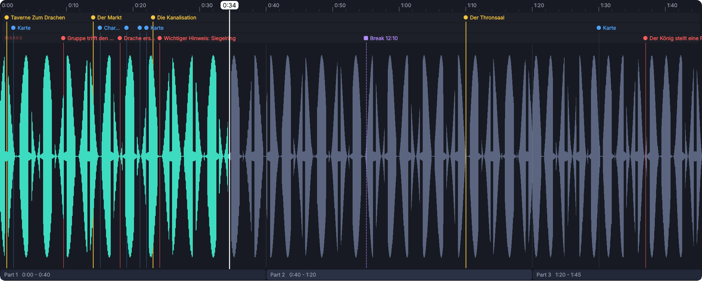

The waveform is drawn in grey, the part you have already played in mint. Above it are three lanes:

| Lane | Colour | Contains |
|---|---|---|
| **Scenes** | yellow | Scene changes (`Scene: 02_Der_Markt` is shown as *Der Markt*). Their line runs through the whole waveform. |
| **Layouts** | blue | Layout changes (map, characters ...). Thin lines, so they stay in the background. |
| **Marks** | red | Manual marks the DM set with Ctrl+M. Breaks are shown here too, in violet, with the real length of the break. |

Move the mouse over the waveform to see the time under the cursor, over a marker for its details.
Click anywhere on the timeline to set the playhead, and drag to scrub.

**Zoom in** (wheel, `+`/`-`, or the overview strip) and every marker gets its label:

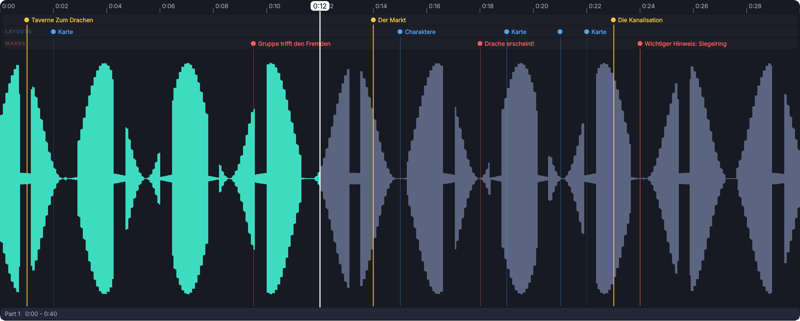

#### Many markers without clutter

Long sessions have hundreds of layout changes. Chronist never hides a marker, it combines them:
markers that would overlap collapse into a **number badge** (click it to zoom in on exactly that spot), labels are only drawn where there is room, and zooming in reveals the rest.

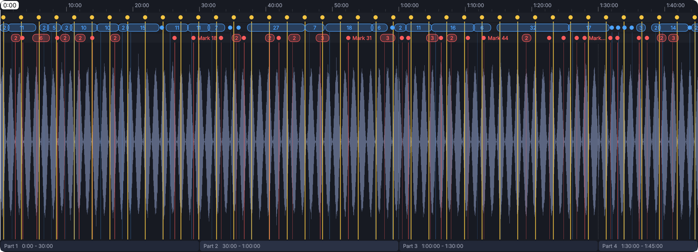

Zoomed to ten minutes of the same session, everything is readable again:

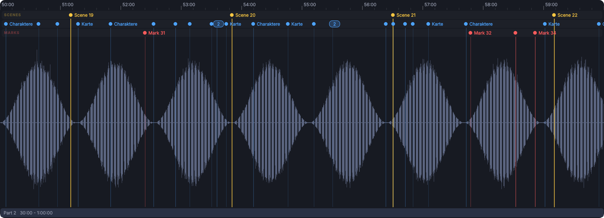

### Overview strip


The strip on top shows the **whole** session with scene and mark ticks. The teal frame is the part you see in the timeline:
drag it to scroll, click outside it to move it there, **double-click** to show the whole session again,
**Shift+click** to move the playhead.

### Transport bar

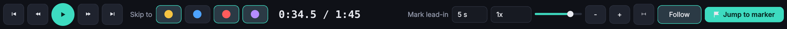

From left to right:

- **Previous / next chapter**, **back / forward 10 s**, **play / pause**
- **Skip to**: the coloured buttons choose which marker types the previous / next chapter buttons stop at (scenes, layouts, marks, breaks)
- Time display: *position / total length*
- **Mark lead-in**: manual marks are set a few seconds *after* the moment the DM meant. Jumping to a manual mark starts this many seconds earlier (default 5 s, 0 = exactly at the mark). Scenes, layouts and breaks are exact and never use it.
- **Speed** (0.75x to 2x), **volume**
- **Zoom out / in**, **show whole session**, **Follow** (scroll the view along with the playhead)
- **Jump to marker**

### Jump to marker

Opens a list of **all** markers, colour coded, sorted by time. The marker at the playhead is highlighted. Type to search by name or time, click a marker and the playhead jumps there.

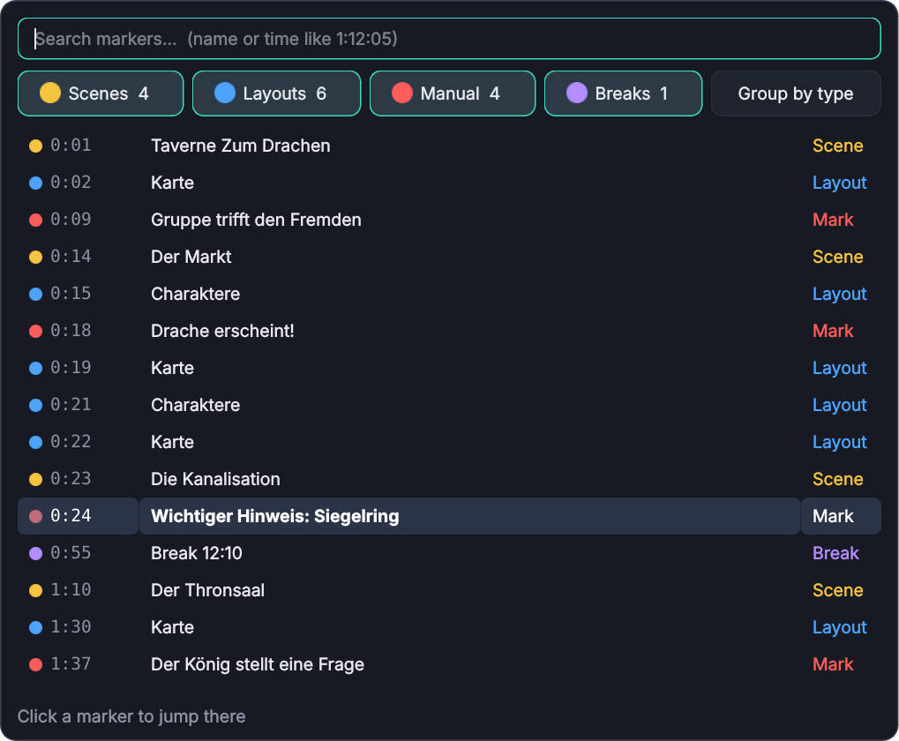

The coloured chips filter by type. **Group by type** switches to separate blocks for scenes, layouts, marks and breaks (the choice is remembered):

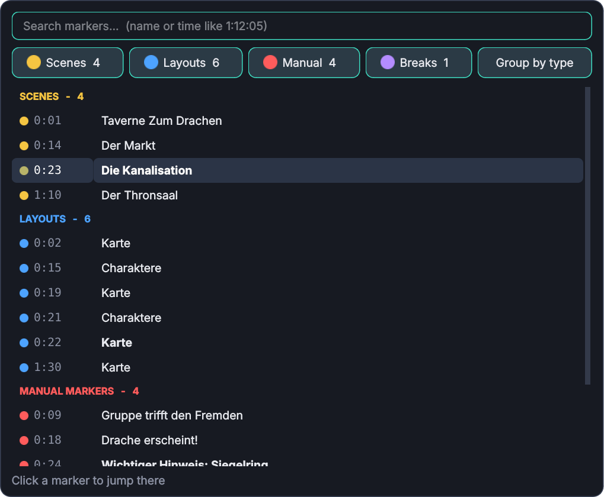

Searching works in both modes:

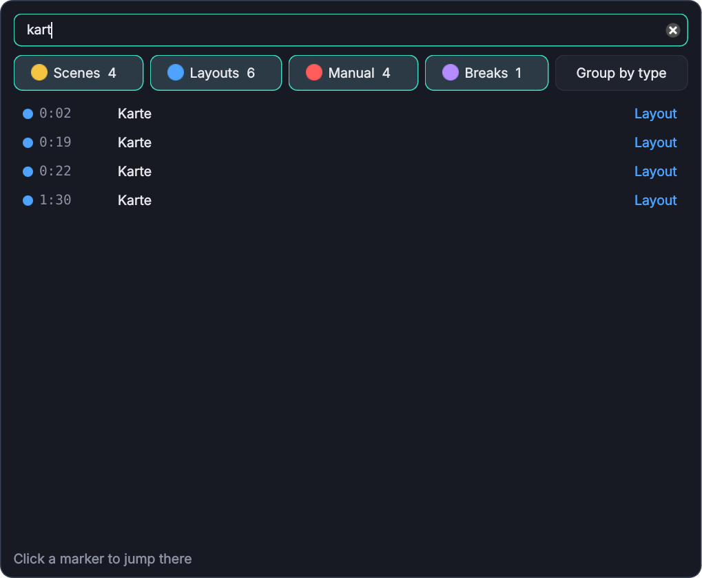

### Now playing

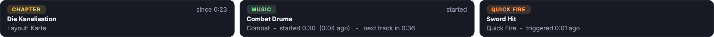

Below the waveform three cards follow the playhead:

- **Chapter**: the current scene, its layout and since when it has been active
- **Music**: the track that is running, when it started and when the next track begins. The music log only records *starts*, so a track counts as playing until the next one starts. Music or slideshows that ran *during a break* are not part of the audio and are ignored.
- **SFX / Quick Fire**: the last sound effect that was triggered and how long ago

### Parts

At the bottom of the timeline a strip shows where each audio part starts and ends (*Part 1 0:00 - 0:40*, *Part 2 ...*). Hover a part for its file name and length. Parts are joined by their real lengths, not by a rounded 30 minutes.

### Transcript

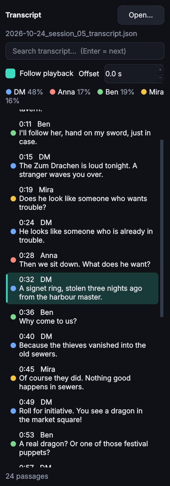

- The passage being said **right now** is marked and the list scrolls along (*Follow playback*, switch it off to read ahead in peace).
- Passages are coloured by speaker; the legend shows each speaker's share of the talking time.
- **Click a passage** to play from there (it starts 1.5 s early, because Whisper timestamps are approximate).
- **Search** shows only matching passages. **Enter** plays from the next match after the playhead.
- **Offset** shifts the transcript against the audio, in case the two do not line up.
- **Open...** picks a transcript file by hand. The panel can be hidden with **T**.

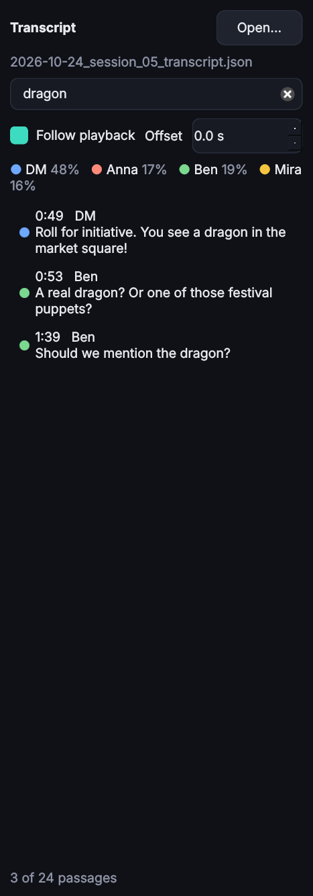

### Sessions that ended in a crash

If something is missing or damaged, Chronist tells you and carries on:

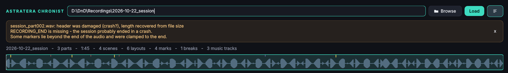

- A damaged WAV header (wrong length after a crash) is repaired from the file size.
- A missing end marker is reported.
- Markers beyond the end of the audio are moved to the end and drawn hollow.
- If a transcript was made from different parts than the folder contains, you get a warning and can correct the times with the offset field.

## Keyboard shortcuts

| Key | Action | Key | Action |
|---|---|---|---|
| **Space** | play / pause | **M** | open the marker menu |
| **←** / **→** | back / forward 5 s (Shift: 30 s) | **[** / **]**, PgUp / PgDn | previous / next chapter |
| **J** / **L** | back / forward 10 s | **+** / **-**, mouse wheel | zoom |
| **Home** / **End** | start / end | **0** | show the whole session |
| **,** / **.** | slower / faster | **T** | show / hide the transcript |
| **↑** / **↓** | volume | **Ctrl+O** | choose folder |

Mouse: left-click / drag on the timeline = playhead, wheel = zoom, Shift+wheel or right-drag = scroll, click on a marker = jump there.

## How the session folder is read

```
2026-10-24_session_05/
    session_05_part000.wav  session_05_part001.wav ...    mono, 44.1 kHz, 16-bit PCM, about 30 min each
    session_05_markers.json                               chapter markers
    session_05_audio_log.json                             music / SFX starts
    transcript/
        2026-10-24_session_05_transcript.json             (+ .txt .srt .vtt: the same transcript in other formats)
```

**Time.** All times in the files are *audio time*: seconds of audio that were actually recorded, counted continuously over all parts.
The recording pauses during breaks, so a break is a single point on the timeline (its length comes from the wall-clock times in the marker file).

**Transcript lookup.** Chronist looks in the session's `transcript` folder for `<session folder name>_transcript.<ext>` (`.json`, `.srt`, `.vtt` or `.txt`).
If the same transcript exists in several formats it opens the richest one: `.json` knows the speakers and the parts it was made from, `.srt`, `.vtt` and `.txt` carry only times and text.
If there are several *different* transcripts and none carries the session's name, Chronist asks which one to open (or lets you browse for a file).
A `.txt` transcript needs a time in front of each passage (`[0:12:05] Anna: ...` or `00:12 text`), otherwise the text cannot be placed on the timeline.

**Large sessions.** The audio is never decoded into memory. The waveform is computed once per part and cached in `%LOCALAPPDATA%\AstrateraChronist\cache`, playback streams straight from the files.

## Run from source

Python 3.9+, PyQt6 and numpy. Nothing else.

```
cd Astratera_Chronist
python -m venv .venv
.venv\Scripts\activate
pip install -r requirements.txt
python astratera_chronist.py            (optionally with a session folder as argument)
```

A fake session to try it out (it contains a transcript in all four formats):

```
python tests/make_test_session.py test_recordings
python astratera_chronist.py test_recordings/2026-10-22_session
```

Tests: `pip install pytest`, then `python -m pytest tests -q`.

## Build the exe

**On your PC:** double-click `build_chronist.bat` (needs Python 3.9+). It builds in a private environment and creates `dist\AstrateraChronist.exe`.
`build_chronist.bat folder` makes a folder build instead, which starts faster.

**On GitHub:** the workflow `.github/workflows/build-chronist.yml` tests, builds and smoke-tests the exe on a Windows runner.
It finds `astratera_chronist.py` by itself, so the folder can sit anywhere in the repository.
GitHub only runs workflows from `.github/workflows` at the **root of the repository**: if `Astratera_Chronist` is a sub-folder, move its `.github` folder to the root.

- *Actions → Build Astratera Chronist (Windows exe) → Run workflow*: the exe appears under **Artifacts**. Untick *onefile* for a folder build, and enter a *release_tag* to publish a Release at the same time.
- Or push a tag: `git tag chronist-v1.0.0 && git push origin chronist-v1.0.0`. The exe is attached to a Release.

The exe is not code-signed, so Windows SmartScreen may ask once (*More info → Run anyway*).

## Troubleshooting

| Problem | Fix |
|---|---|
| No sound | Check the Windows default output device. `CHRONIST_NO_AUDIO=1` switches sound off completely (analysis only). |
| Transcript is off by a few seconds | It was probably made from different parts. Use the **Offset** field in the transcript panel. |
| No transcript opens | It must be in the session's `transcript` folder and end in `.json`, `.srt`, `.vtt` or `.txt`. Otherwise use **Open...**. A `.txt` without times cannot be used. |
| "No *_partNNN.wav files" | Choose the folder that directly contains the `_part000.wav` files (or its parent). |
| Waveform stays on "Analysing" | Very large sessions need a moment the first time. The result is cached afterwards. |
| Jumping to a mark lands a bit early | That is the **Mark lead-in** (default 5 s). Set it to 0 s for exact jumps. |

## Project files

| File | Purpose |
|---|---|
| `astratera_chronist.py` | Main window, loading, transport, shortcuts (start here) |
| `chronist_core.py` | Reads the recording: WAV parts, markers, audio log, transcripts, peak cache |
| `chronist_audio.py` | Gapless multi-part playback with pitch-preserving speed change |
| `chronist_timeline.py` | Waveform with marker lanes, overview strip |
| `chronist_panels.py` | Marker menu, now-playing cards, transcript panel |
| `chronist_theme.py` | Colours, style sheet, icons drawn in code |
| `tests/` | pytest suite and the fake-session generator |
| `build_chronist.bat` | Local exe build |
| `.github/workflows/build-chronist.yml` | GitHub Actions build of the Windows exe |
| `assets/` | Icon of the exe and the README |
| `docs/screenshots/` | Screenshots used in this README |

## License

Source code: MIT, like the rest of the repository. The Windows exe bundles PyQt6 and is therefore distributed under GPL-3.0
(see the repository's `LICENSE` and `THIRD_PARTY_NOTICES.md`). Unofficial fan tool, not affiliated with Wizards of the Coast.
